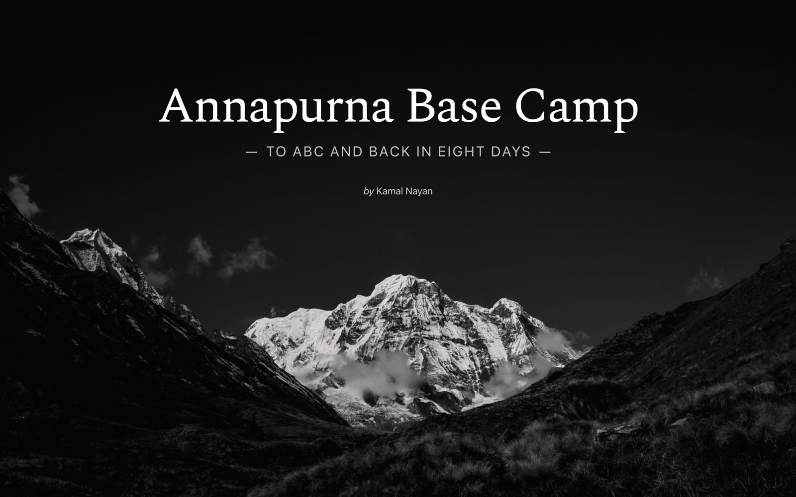

# Annapurna Base Camp Trek

An interactive journey to Annapurna Base Camp and back, over eight days. When you scroll the story, the map follows the route.

**Live site:** [abc.kamalnayan.co](https://abc.kamalnayan.co/)

[](https://abc.kamalnayan.co/)

## Development

Install the dependencies:

```sh
npm install
```

Serve the site from `dist` and open it in your browser:

```sh
npm start
```

Build `dist/app.js` from `src`:

```sh
npm run build
```

Rebuild when a file in `src` changes:

```sh
npm run watch
```
